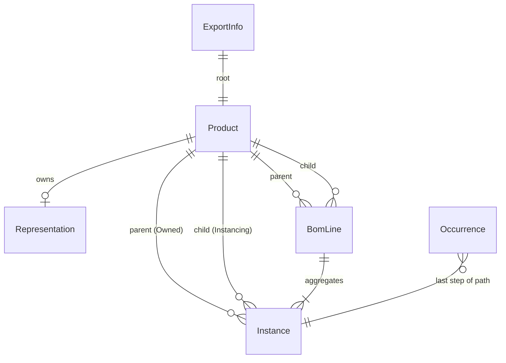

# XML to data model mapping

Field-by-field mapping of `data/raw/XPDMXML_ECAR_PLM.xml` to a proposed data model. It builds on [xml_structure.md](xml_structure.md) and is meant as a basis for discussion: entity names, keys and the open questions at the end still need a team decision.

Every XML value is a string. The "Type" column gives the target type after parsing, "Fill" the number of filled values over the number of elements, and "Use" the app capability that needs the field (Explorer, Intelligence, Change Impact, Traceability).

## Proposed entities

| Entity | Source | Count | Nature |
|---|---|---|---|
| `ExportInfo` | `InfoHeader/Info` | 1 | Metadata of the export |
| `Product` | `Product` | 79 | Reference: a part or an assembly, independent of where it is used |
| `Instance` | `ProductInst` | 112 | One use of a product inside a parent product |
| `Representation` | `Rep3DAggr` | 36 | 3D representation attached to a leaf product |
| `BomLine` | derived from `Instance` | 80 | Aggregated (parent, child, quantity) line |
| `Occurrence` | derived from the tree | 144 | One node of the fully expanded tree, identified by its path from the root |
| `SourceRef` | embedded | – | Link from any model object back to its XML element |

`Product` and `Instance` follow the 3DEXPERIENCE reference/instance pattern directly. `BomLine` and `Occurrence` do not exist in the XML: they are computed, and each one keeps the list of instances it comes from so that derived values stay traceable.

## Traceability

Every entity read from the XML carries a `SourceRef`:

| Field | Content | Example |
|---|---|---|
| `file` | Source file name | `XPDMXML_ECAR_PLM.xml` |
| `element` | XML tag | `Product` |
| `xml_id` | `@id` attribute | `ID_41` |
| `xid` | `UniqueID/@XID` | `05C78E12D8C63ED9010179C96BD0AE79010217A0` |
| `line` | Line number of the opening tag | `800` |

`xml.etree` does not expose line numbers; `lxml` does, through `element.sourceline`.

Derived values (quantities, rolled-up masses, where-used paths, risk flags) must list the `SourceRef`s they were computed from. For example, the quantity 14 on the `HOUSING FRONT EDRIVE → Screw D10 L155` BOM line points to the 14 `ProductInst` elements that produce it.

## Mapping: `InfoHeader` → `ExportInfo`

The header is a flat list of `<Info name="..." value="..."/>`. It maps to a key/value dictionary; only a few keys matter for the app.

| `@name` | Value in this file | Target | Note |
|---|---|---|---|
| `SourceObjectRef` | `ID_0` | `root_xml_id` | Same as `ProductStructure/@rootRefs` |
| `SourceObjectExternalID` | `05C7...170A` | `root_xid` | Equal to the root product's XID |
| `CompletionType` | `Expand=-1` | `completion` | Full expansion, so the tree is complete |
| `WithProcess` | `Yes` | kept raw | No process object in the file despite `Yes` |
| `FileFormat3D`, `FileFormat2D` | `CATIAV5-6R2026` | kept raw | Informational |
| `GeometryType3D` | `Tessellated` | kept raw | Informational |
| `WithFiles`, `WithPrimaryFiles`, `SecondaryFiles`, `WithDocuments`, `WithPLMParams`, `WithAlternateReference`, `WithoutMapping`, `FilterXPDMOwnedObjects` | `No` | kept raw | Explains why no files, documents or parameters are present |

## Mapping: `Product` → `Product`

| XML path | Target field | Type | Fill | Transformation | Use |
|---|---|---|---|---|---|
| `@id` | `source.xml_id` | str | 79/79 | none | Traceability, resolving `Owned`/`Instancing` |
| `ID` | `plm_id` | str | 79/79 | none; unique, format `prd-12535825-NNNNNNNN` | Business key, join key for enrichment data |
| `Name` | `name` | str | 79/79 | kept raw for display | Explorer |
| `Name` | `name_normalized` | str | 79/79 | strip, collapse whitespace, remove space after `ECAR-EI_` / `ECAR-3D_`, treat `ECAR-3D ` as `ECAR-3D_` | Search; not a key (73 distinct values) |
| `Description` | `description` | str \| None | 3/79 | `""` → `None` | Explorer |
| `UniqueID/@XID` | `xid` | str | 79/79 | none; 40 hex chars, unique | Stable identifier, traceability |
| `UniqueID/@External` | dropped | – | 79/79 | always equal to `XID` | – |
| `UniqueID/@locationOfControl` | dropped | – | 79/79 | constant `V6` | – |
| `RevisionName` | `revision` | str | 79/79 | none; A to D | Explorer (version display) |
| `RevisionIndex` | `revision_index` | int | 79/79 | `int()` | Ordering revisions |
| `RevisionFamily` | `revision_family` | str | 79/79 | none; 32 hex chars | Groups revisions of the same item; all distinct in this file |
| `Maturity` | `maturity` | enum | 79/79 | none; only `IN_WORK` observed | Explorer, Intelligence (lifecycle risk) |
| `Lifecycle` | `lifecycle` | str | 79/79 | none; constant `VPLM_SMB_Definition_MajorRev` | Explorer |
| `TimeCreated` | `created_at` | datetime (UTC) | 79/79 | parse `2026-10-14T16:29:23.0Z` | Explorer |
| `TimeModified` | `modified_at` | datetime (UTC) | 79/79 | same | Explorer |
| `Owner` | `owner` | str | 79/79 | none; constant `admin_platform` | Explorer |
| `Organization` | `organization` | str | 79/79 | none; constant `Company Name` | Explorer |
| `Project` | `project` | str | 79/79 | none; constant `ECAR_PLM` | Explorer |
| `SecurityLevel` | `security_level` | int | 79/79 | `int()`; constant `-1` | – |
| `WCGEquivalentComputedExt.V_WCG_Mass` | `mass_kg` | float | 79/79 | `float()`; unit not stated, kg assumed | Explorer, Intelligence, Change Impact, sustainability |
| `Material` | `material` | str \| None | 73/79 | `""` → `None`; empty only on the 6 real assemblies | Intelligence, sustainability |

Fields derived on `Product`:

| Field | Rule | Note |
|---|---|---|
| `is_root` | `@id` equals `rootRefs` | Exactly one root |
| `is_leaf` | no `Instance` has this product as parent | 36 leaves |
| `has_representation` | a `Rep3DAggr` owns it | Same 36 products as the leaves |
| `item_kind` | `assembly`, `wrapper` or `part` | `wrapper`: exactly one child, which is a leaf with quantity 1 (37 cases). Based on structure, not on the `ECAR-EI` / `ECAR-3D` prefixes |

## Mapping: `ProductInst` → `Instance`

| XML path | Target field | Type | Fill | Transformation | Use |
|---|---|---|---|---|---|
| `@id` | `source.xml_id` | str | 112/112 | none | Traceability |
| `ID` | `instance_name` | str | 112/112 | none; unique within a parent only (107 distinct values) | Explorer |
| `Name`, `Description` | dropped | – | 0/112 | always empty | – |
| `UniqueID/@XID` | `xid` | str | 112/112 | none; unique | Traceability |
| `UniqueID/@External`, `@locationOfControl` | dropped | – | 112/112 | as for `Product` | – |
| `RevisionFamily` | `revision_family` | str | 112/112 | none; all distinct | Kept raw, no identified use |
| `TimeCreated`, `TimeModified` | `created_at`, `modified_at` | datetime (UTC) | 112/112 | as for `Product` | – |
| `Owner`, `Organization`, `Project`, `SecurityLevel` | as for `Product` | – | 112/112 | constants | – |
| `Owned` | `parent_id` | FK → `Product` | 112/112 | resolve `@id`; 43 distinct parents | Explorer, Change Impact |
| `Instancing` | `child_id` | FK → `Product` | 112/112 | resolve `@id`; 78 distinct children (every product except the root) | Explorer, Change Impact |
| `ChildOrder` | `child_order` | float | 112/112 | `float()`; all distinct | Sort children for display |
| `RelativeTransformation3D/Rotation3D` | `rotation` | 9 floats | 112/112 | split on spaces; 3×3 matrix, row/column order to confirm | Optional spatial view |
| `RelativeTransformation3D/Translation3D` | `translation` | 3 floats | 112/112 | split on spaces; unit not stated, metres assumed (max 0.405) | Optional spatial view |

`instance_name` follows the pattern `<child name without "ECAR-">.<n>` in 92 of 112 cases (`EI_HSH.1`). The other 20 do not (`HSH.1` for `ECAR-3D_HSH`, `KHR6-1Hackathon_YJE2-ECAR-EI_Screw D10 L155.1`), so it must not be parsed to recover the child.

## Mapping: `Rep3DAggr` → `Representation`

| XML path | Target field | Type | Fill | Transformation | Use |
|---|---|---|---|---|---|
| `@id` | `source.xml_id` | str | 36/36 | none | Traceability |
| `@updateFileMode` | dropped | – | 36/36 | constant `IgnoreExistingNotProvided` | – |
| `ID` | `plm_id` | str | 36/36 | none; format `3sh-12535825-NNNNNNNN` | Explorer |
| `Name` | `name` | str | 36/36 | none; not unique (`ECAR-01_GearWheel` ×3) | Explorer |
| `Description` | dropped | – | 0/36 | always empty | – |
| `UniqueID/@XID` | `xid` | str | 36/36 | none | Traceability |
| `RevisionName`, `RevisionIndex`, `RevisionFamily` | `revision`, `revision_index`, `revision_family` | str, int, str | 36/36 | as for `Product` | Explorer |
| `Maturity`, `Lifecycle` | `maturity`, `lifecycle` | enum, str | 36/36 | only `IN_WORK` observed | Explorer |
| `TimeCreated`, `TimeModified`, `Owner`, `Organization`, `Project`, `SecurityLevel` | as for `Product` | – | 36/36 | constants | – |
| `Owned` | `product_id` | FK → `Product` | 36/36 | resolve `@id`; 1:1 with leaf products | Explorer |

No geometry file is attached (`WithFiles=No`). A representation therefore only proves that the leaf has 3D, with its own revision and maturity.

## Derived entities

### `BomLine`

Group `Instance` by (`parent_id`, `child_id`):

| Field | Rule |
|---|---|
| `parent_id`, `child_id` | Grouping key |
| `quantity` | Number of instances in the group |
| `instance_ids` | `@id` of the grouped instances (traceability) |
| `order` | Minimum `child_order` of the group |

This gives 80 lines from 112 instances. The groups with quantity above 1 are listed in [xml_structure.md](xml_structure.md#quantities-and-reuse).

### `Occurrence`

One node per path from the root in the expanded tree: 144 occurrences, maximum depth 4. A path is the ordered list of instance `@id`s from the root. Occurrences answer "where is this part used, and how many times in the whole e-drive", which is what Change Impact needs. Total quantities in the root are the product of quantities along each path (`Screw D10 L155`: 14).

With 79 products, occurrences can be computed on demand instead of stored.

### Rolled-up values

| Value | Rule | Check |
|---|---|---|
| `rolled_mass_kg` | sum over `BomLine` of `quantity × child.mass_kg` | Equals `mass_kg` on all 43 assemblies; root gives 100.1 kg |
| `total_quantity` | sum over occurrences of a product | |

## Load-time validation

The parser should fail loudly if any of these break on a future export:

- exactly one root, matching `rootRefs` and `SourceObjectRef`;
- every `Owned`, `Instancing` and `Rep3DAggr/Owned` resolves to an existing `Product`;
- no cycle in the structure;
- `@id`, `ID` and `XID` unique per element type;
- rolled-up mass matches `mass_kg` on every assembly (tolerance 1e-3 kg), reported as a warning rather than an error.

## Data outside the XML

Supplier, cost, make/buy, lead time and criticality are absent from the extract. If the app needs them, they come from a separate enrichment file with its own entities, for example:

| Entity | Fields | Key |
|---|---|---|
| `Supplier` | `supplier_id`, `name`, `country` | `supplier_id` |
| `Sourcing` | `plm_id`, `supplier_id`, `unit_cost`, `currency`, `lead_time_days`, `single_source` | (`plm_id`, `supplier_id`) |
| `MaterialFactor` | `material`, `co2_kg_per_kg`, `source` | `material` |

These records carry a `SourceRef` pointing to the enrichment file, not to the XML, and the UI must show the difference.

## Open questions

1. **Primary key.** Settled in [data_contract.md](data_contract.md#keys): `plm_id` is the key exposed to modules and used for enrichment joins, `xid` identifies instances, `@id` only appears in `SourceRef`.
2. **EI/3D granularity.** Show both levels in the Explorer, or merge each wrapper with its part into one component (37 pairs, plus `MOTOR SCREW 2` which has no wrapper)? The model can keep both and let the UI choose.
3. **Units.** Mass in kg and translation in metres are assumptions consistent with the values (100.1 kg for a 410 kW e-drive, offsets under 0.5 m), not stated in the file.
4. **Stator meshing parts.** Keep `STATOR Core Tooth` and `STATOR Coil` as normal parts, or flag them as modelling artefacts so they do not count twice in mass or carbon totals?
5. **Storage.** At this size (79 products, 112 instances), an in-memory graph is enough. A database is only worth it if enrichment data or several exports have to be combined.
6. **Enrichment scope.** Which fields from the table above does the demo actually need, and who builds the assumptions behind them?
